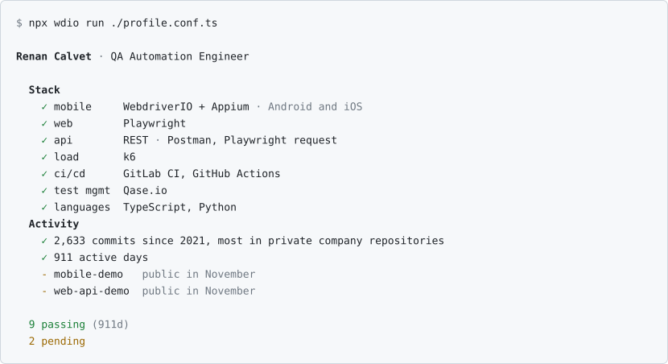
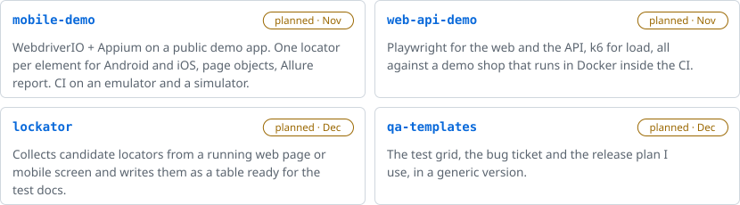
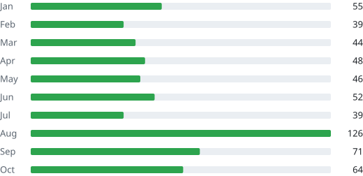

<picture>
  <source media="(prefers-color-scheme: dark)" srcset="assets/terminal-dark.svg">
  
</picture>

## Hi, I'm Renan

I'm a QA automation engineer. From , currently living in .

I build test suites for mobile and web products: Playwright for the web, WebdriverIO and Appium on Android and iOS (XCode), Postman and Playwright for REST APIs, k6 for load. The suites run in CI/CD pipelines on GitLab and GitHub. Most of my work lives in private company repositories, so the graph below shows only part of it.

### Things I test with

              

### Public demos

<picture>
  <source media="(prefers-color-scheme: dark)" srcset="assets/demos-dark.svg">
  
</picture>

### 2026 so far

584 commits on 174 days.

<picture>
  <source media="(prefers-color-scheme: dark)" srcset="assets/months-dark.svg">
  
</picture>

### Where to find me

 

 

This account was created in March 2025 after I lost access to my previous one. The activity from 2021 to 2025 was imported from that account's contribution history.
